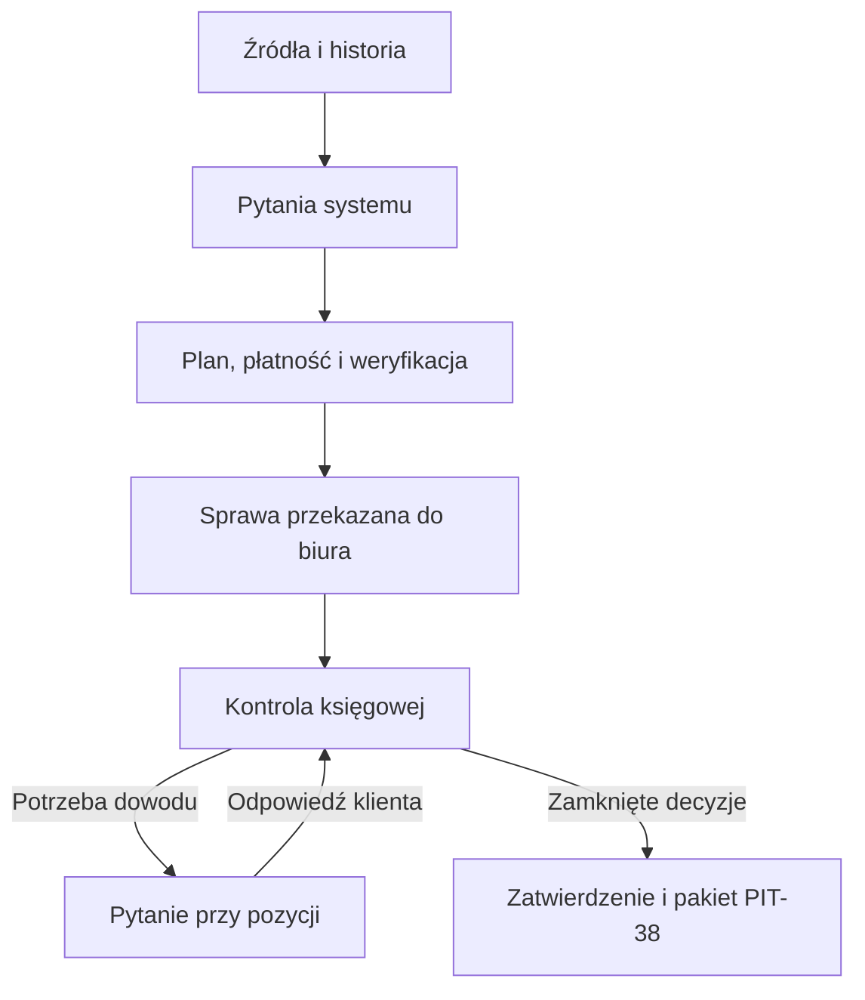

# Dokumentacja makiety KryptoTax

Makieta przedstawia usługę rozliczenia kryptowalut w PIT-38. Klient przekazuje dane, system porządkuje historię i wskazuje braki, a księgowa rozstrzyga otwarte pozycje i zatwierdza wynik. Biuro jest właścicielem aplikacji, świadczy usługę i odpowiada za rozliczenie. Dokumentacja opisuje wersję makiety z commita `2867e72`. Import, wyliczenia, ceny, płatności, weryfikacja i dokumenty są symulowane. [Makieta](../working/kryptotax-mockupy.html) · [Wersja źródłowa](https://github.com/adamskrodzki/crypto-tax-mvp/blob/2867e726aef7a66ea0392bff90f67d8fc96e284b/working/kryptotax-mockupy.html) · [Założenia projektu](../AGENTS.md)

| Obszar | Co opisuje |
| --- | --- |
| [Portal klienta](portal-klienta.md) | Sześć kroków, wszystkie wybory źródeł i metod importu, warunki przejścia, edycja oraz uzupełnienia po przekazaniu do biura |
| [Operacje, dowody i decyzje](operacje-i-dowody.md) | Dopasowanie transferów, pytania i odpowiedzi, możliwe rozstrzygnięcia, wspólna historia, dokumenty i powiązanie danych między rolami |
| [Wycena, płatności i weryfikacja](wycena-i-platnosci.md) | Wzory i zakresy szacunku, plany, progi wyboru, osobna opłata za agregator i moment uruchomienia KYC/AML |
| [Panel księgowej](panel-ksiegowej.md) | Kolejka i filtry, praca nad konkretną pozycją, obieg pytań, podstawa decyzji i warunki zatwierdzenia |
| [Scenariusze i dane przykładowe](scenariusze.md) | Stan Marty, Piotra i Anny, dane wstawiane przez makietę i ścieżki do przejścia z obiema rolami |
| [Otwarte decyzje i ograniczenia](otwarte-decyzje.md) | Różnice względem założeń projektu, reguły przyjęte na potrzeby makiety i znane luki |

## Decyzje stojące za układem

Punktem wyjścia był kreator w widokach Anny i Marty oraz kolejka spraw, zadania i grupowana historia w widoku księgowej. Obie role pracują teraz na tej samej sprawie. [Makiety wyjściowe](../working/mockup-szefa/)

| Decyzja | Uzasadnienie w tym przepływie |
| --- | --- |
| Portal klienta prowadzi przez kroki zależne od danych. | Na danym etapie klient widzi czynność, którą może wykonać, i warunek przejścia dalej. Historia, dokumenty i zdarzenia są dostępne po zebraniu danych. |
| Księgowa zaczyna od kolejki spraw albo kolejki zadań. | Biuro prowadzi wiele spraw i potrzebuje od razu wiedzieć, kto ma wykonać następny ruch i jakiej pozycji to dotyczy. |
| Pierwsze rozpoznanie opiera się na roku, źródłach i wcześniejszym PIT-38. | Klient zna używane giełdy i portfele. Liczbę operacji można ustalić z historii, więc kreator pomija pytanie o jej szacowanie. |
| Każde zadeklarowane źródło ma własny stan i dostępne metody. | Wybór na pierwszym ekranie określa pracę na następnym. Klient może uzupełniać giełdy, sieci i operacje spoza eksportów w dowolnej kolejności. |
| Bezpłatne rozpoznanie poprzedza zakup planu. | Typ źródeł i wynik dostępnych importów pozwalają zawęzić zakres sprawy. Płatna metoda ma cenę i osobne potwierdzenie przed uruchomieniem. |
| Operacja lub wcześniejszy PIT-38 jest miejscem wymiany pytań i dowodów. | System pyta o konkretny brak. Księgowa widzi tę samą pozycję i odpowiedź, a w razie potrzeby może do niej wrócić z własnym pytaniem. |
| Własny transfer można rozpoznać po dwóch zgodnych zapisach. | Dopasowanie usuwa potrzebę pytania o znany transfer. Przy braku pary klient widzi fakty z importu, a ustalenie ewentualnej wartości w PLN należy do księgowej. |
| Plan zależy od szacowanego podatku i czasu księgowej. | Pierwsza miara opisuje możliwą odpowiedzialność biura, druga przewidywaną pracę. Weryfikacja następuje po zakupie, a księgowa zatwierdza sprawę po rozstrzygnięciu braków. |
| Klient przekazuje gotową sprawę do biura jednym krokiem. | Kolejka biura zawiera sprawy, które przeszły zebranie danych, wycenę, płatność i weryfikację. Księgowa skupia się na sprawdzeniu materiałów i rozstrzyganiu pozycji. |
| Zatwierdzenie daje wgląd w wynik i pakiet PIT-38. | Stan zatwierdzenia przez księgową i status złożenia deklaracji to osobne informacje. |

## Obieg jednej sprawy

Klient może wracać do źródeł i zmieniać dane przed zakupem planu. Po przekazaniu sprawy nowy materiał trafia do biura jako odpowiedź na pytanie przy pozycji. Pasek nad aplikacją służy do zmiany roli i scenariusza podczas prezentacji. [Sterowanie i scenariusze](scenariusze.md)
